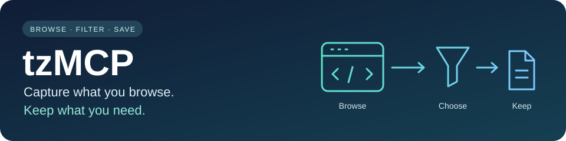
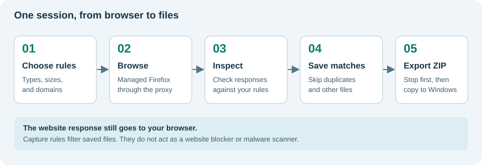

<p align="center">
  
</p>

<p align="center">
  <strong>Browse a website. Save the files that match your rules. Export the results.</strong><br>
  Python 3.12+ · Desktop interface and command line · MIT license · Alpha software
</p>

tzMCP stands for **Taggedz Media Capture Proxy**. It saves selected files from web traffic, such as images, videos, audio, documents, and some web page files. You choose which file types, sizes, and websites to keep.

A **proxy** sits between a browser and a website. tzMCP uses mitmproxy to inspect the responses coming back to the browser and save matching files.

> **Project status:** The intended everyday-user version runs inside a VirtualBox virtual machine. A **virtual machine (VM)** is a separate computer running in a window on your computer. The appliance is still in development; this repository does not provide a published production OVA. An **OVA** is the file used to import the ready-made VM. See the [appliance guide](docs/appliance.md) for candidate status. The Python setup is for developers and testing.

**Find your path:** [First capture](#your-first-capture) · [Capture rules](#choose-what-to-save) · [Export](#get-your-files-out) · [Troubleshooting](#when-something-goes-wrong) · [Developer and security guide](docs/DEVELOPER_SECURITY_GUIDE.md)

## What you can do

| Goal | How tzMCP helps |
| --- | --- |
| Collect images while browsing | Save matching image responses as they arrive. |
| Skip thumbnails or oversized files | Set file size and image width/height limits. |
| Focus on particular websites | Use a domain allow list and block list. |
| Avoid saving identical content twice | Compare file contents using SHA-256, a digital fingerprint. |
| Keep a session together | The GUI puts captures and settings into a session folder. |
| Move results out of the appliance | Export a ZIP archive with captures, metadata, and checksums. |

tzMCP saves files the browser actually requests through the proxy. It does not crawl a whole website, assemble a complete offline website, or combine video segments into a finished movie. Some sites and protected media will not work.

## How capture works



The browser still receives the website response when a file is skipped. **Capture rules decide what gets saved; they do not block the browser from visiting a site.**

## Before you begin

**Use only traffic and content you have permission to capture.** The [usage notice](docs/CYA_NOTICE.md) explains the project's intended use.

tzMCP decrypts HTTPS traffic passing through its proxy. Do not sign in to personal accounts or enter passwords, payment details, recovery codes, or other private information in the capture browser. A private browsing window does not prevent the proxy from seeing that traffic.

Captured files may contain harmful content. Treat exports as untrusted downloads, especially HTML, scripts, documents, and executables. File type filters are not a malware scanner.

## Get the appliance ready

The intended host is **64-bit Windows with VirtualBox 7.1 or newer**. The default VM uses 4 GiB of memory, one virtual CPU, and a dynamically growing 60 GiB disk. Your computer needs room for the VM, captures, and exported ZIP files.

These instructions apply when a release provides an OVA, `SHA256SUMS`, and `Setup-tzMCP.ps1`. Do not assume an arbitrary OVA is an official release.

### Check the download

1. Put the release files together in a folder and open PowerShell there.
2. Calculate the OVA's fingerprint and compare it with the value in the release's `SHA256SUMS` file.

```powershell
Get-FileHash .\tzMCP-appliance.ova -Algorithm SHA256
```

The filename above is an example; use the filename supplied with the release. A matching checksum detects changed bytes. It does not establish who published the file, so obtain the checksum from a trusted release source.

### Import and start

1. Replace `PASTE_THE_PUBLISHED_SHA256_HERE` below with the matching checksum, then run the command.
2. In the VM desktop, open **tzMCP Capture**.

```powershell
.\Setup-tzMCP.ps1 -OvaPath .\tzMCP-appliance.ova -ExpectedSha256 'PASTE_THE_PUBLISHED_SHA256_HERE'
```

The script imports the VM, applies its boundary settings, and starts it. It leaves your host browser, Windows proxy, and host certificate store unchanged. Certificates are the records a browser uses to decide which secure connections it trusts.

For a different export folder or VM disk location, see the [appliance installation guide](docs/appliance.md#install).

## Your first capture

Follow one short stage at a time. You can return here between stages.

### Choose the files

1. Open **Capture Rules** and select **Image** for a first test. No file types are selected by default.
2. Select **Save Configuration**.

The default rules skip files smaller than 10 KiB and images smaller than 301 pixels in either direction. See [capture rules](#choose-what-to-save) if you need smaller files.

### Start browsing

1. Open **Capture Session** and select **Start proxy**. Wait for the running message.
2. Select **Launch Firefox**, then browse a public page you have permission to capture.

The appliance prepares a separate Firefox profile with its proxy and certificate settings. You do not need to configure a host browser or install a host certificate.

### Finish the session

1. Open **Activity** to see which files were saved or skipped.
2. Return to **Capture Session** and select **Stop** when you are done.

**Stop** closes managed Firefox and the proxy. Session rules are copied when capture starts. Save changes before starting your next session; they do not change the appliance session already running.

## Choose what to save

Open **Capture Rules** before starting a session. Make a small change, save it, and test with a short browsing session.

| Setting | What it means | Starting advice |
| --- | --- | --- |
| Allowed MIME Groups | Broad file categories; MIME means file type. | Start with **Image**. Add **Video**, **Audio**, **Text**, or **Document** as needed. |
| File Size Filter | Smallest and largest files to save, measured in bytes. | Defaults: 10,240 to 157,286,400 bytes (10 KiB to 150 MiB). |
| Image Dimension Filter | Smallest and largest width and height, measured in pixels. | Defaults: 301–12,000 pixels in each direction. |
| Whitelist Domains | Websites whose files may be saved. | Leave empty to allow any source domain. |
| Blacklist Domains | Websites whose files should be skipped. | A block entry wins over an allow entry. |
| Log to File | Keep diagnostic messages on disk. | Off by default. Logs may include browsing information. |
| Log Level | How much detail appears in activity/file logs. | Keep **INFO** for normal use. |
| Persistent Deduplication | Remember file fingerprints across proxy runs. | Off by default; turn on only if you want previously saved content skipped later. |

**Text** covers supported text types, including HTML, CSS, and JavaScript. There are no separate `html`, `css`, or `js` groups. **Executable** allows potentially dangerous program files and should be left unchecked for ordinary capture.

For a domain entry, use a hostname such as `example.com`, one per line. It also matches subdomains such as `images.example.com`, but not `notexample.com`. Do not paste a whole page URL. Some sites serve images from a different domain; that source needs to be allowed too.

The appliance stores captures inside each session, even though the shared settings screen includes **Save Directory**. Change the host export folder during appliance setup. **Auto Reload Config** does not change a running appliance session.

See the [settings guide](docs/CONFIG_TAB_GUIDE.md) for examples and the [technical configuration reference](docs/DEVELOPER_SECURITY_GUIDE.md#configuration-reference) for exact behavior and limitations.

## Get your files out

1. After **Stop**, select **Export Session**.
2. On your Windows computer, open the export folder. Its default location is `Documents\tzMCP Exports` under your user account.

Open the ZIP and extract it into a new folder before reviewing the files. Export the finished or recovered session before starting another one.

```text
<session-id>.zip
├── SHA256SUMS                  File fingerprints for integrity checks
└── <session-id>/
    ├── capture/                Saved files
    ├── logs/                   Session log files, when present
    ├── capture-config.yaml     Rules used for this session
    └── session.json            Times, totals, warnings, and versions
```

The export excludes the managed browser profile and the proxy's certificate private key. Captured content is kept as received; it can still contain private data. Log cleanup removes some known sensitive patterns, but it is not a guarantee that an archive is safe to share.

If copying to Windows fails, the completed local archive stays inside the VM. Check the folder and available disk space, then retry **Export Session**. Export copies the results; it does not erase the original captures inside the VM.

## When something goes wrong

Use the first action for your symptom, then check **Activity** for the result.

| Symptom | First useful action |
| --- | --- |
| Nothing is saved | Check that a MIME group is selected and saved before capture starts. |
| Small pictures are missing | Lower the minimum file size and image dimensions for the next session. |
| A site's images are missing | Check Activity for the source domain and any allow-list rejection. |
| A file says “duplicate” | Identical bytes were saved earlier; persistent deduplication can remember earlier runs too. |
| Proxy will not start | Read the startup error in Activity; another process may already use the configured port. |
| Firefox shows certificate errors | Stop the session and check Activity. Use managed Firefox inside the VM; do not install a certificate on Windows to fix this. |
| “No space left on device” | Free space inside the guest before retrying capture or export. Do not delete the session you need. |
| Export fails | Check host and guest free space and the configured Windows export folder, then retry. |
| The app or VM crashed | Reopen tzMCP; it can recover the active session as **INTERRUPTED** for export. |

Saved captures and the appliance's rules persist across VM reboots. The managed Firefox profile is removed after normal session cleanup. Profile deletion is not secure disk erasure, and a crash can leave temporary data behind.

When reporting a problem, include the exact error, appliance/app version, and what you did just before it happened. Review logs for private information before sharing them.

## How the VM separates capture from your computer


The standard setup uses NAT networking with no port forwarding. Shared clipboard, drag and drop, USB passthrough, and VirtualBox remote desktop are disabled. The export share is mounted only for the export operation.

The VM reduces contact with your everyday environment. It does not make hostile websites or downloaded files harmless, and NAT does not isolate it from every destination on your local network. See the [security review](docs/DEVELOPER_SECURITY_GUIDE.md#security-model-and-trust-boundaries) for the exact boundary.

## Modify or develop tzMCP

For everyday changes, use **Capture Rules**. For code changes, use the [developer and security guide](docs/DEVELOPER_SECURITY_GUIDE.md). It covers source installation, command-line usage, architecture, tests, and where to change each feature.

Native GUI and CLI workflows remain development tools. They do not provide the appliance's host boundary. The guide also lists current native-workflow limitations.

| Documentation | Audience |
| --- | --- |
| [Appliance guide](docs/appliance.md) | Users installing, capturing, exporting, or recovering sessions |
| [Capture settings](docs/CONFIG_TAB_GUIDE.md) | Users adjusting filters |
| [Developer and security guide](docs/DEVELOPER_SECURITY_GUIDE.md) | Contributors, advanced operators, and security reviewers |
| [Appliance build guide](docs/appliance-build.md) | Maintainers building and verifying release images |
| [Contributing](CONTRIBUTING.md) | Contributors preparing changes |
| [Usage notice](docs/CYA_NOTICE.md) · [MIT license](LICENSE) | Users and contributors |

Built with [mitmproxy](https://mitmproxy.org/), Tkinter, Pillow, and the other dependencies declared in [pyproject.toml](pyproject.toml).
