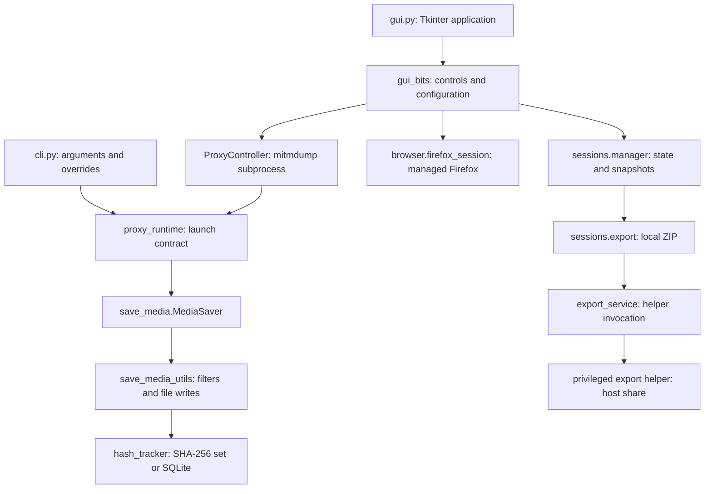
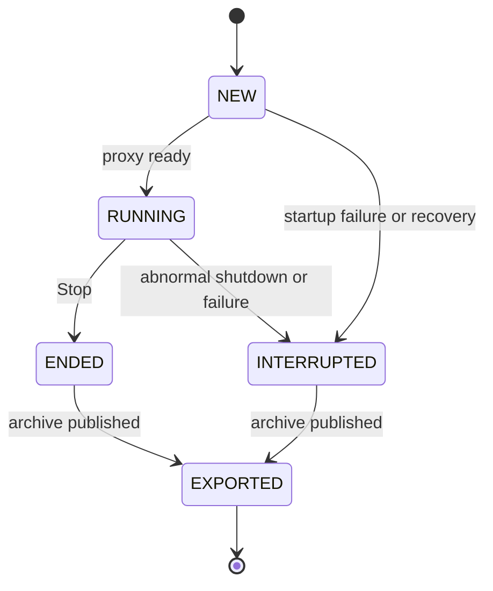
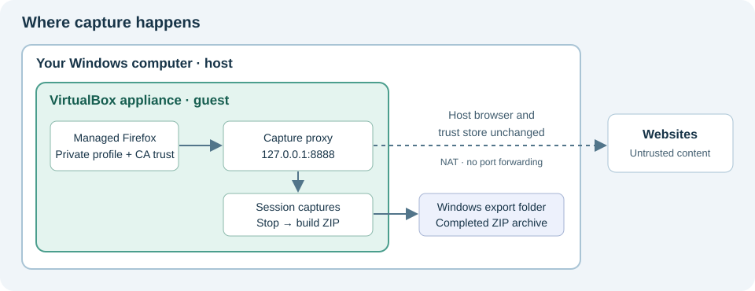
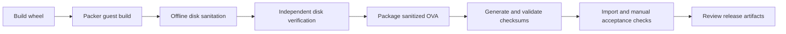

# tzMCP developer and security guide

This is the implementation reference for contributors, advanced operators, and security reviewers. For the everyday capture workflow, start with the [README](../README.md). For image construction and release gates, use the [appliance build guide](appliance-build.md).

The descriptions below reflect the repository implementation, not a claim of an independent security audit. tzMCP is alpha software. The intended user product is a versioned VirtualBox appliance; native GUI/CLI operation is retained for development. A published production OVA is not supplied by this repository.

**Contents:** [Setup](#development-setup) · [Architecture](#architecture-and-module-map) · [Capture pipeline](#capture-pipeline) · [Configuration](#configuration-reference) · [CLI](#command-line-reference) · [Storage](#runtime-storage) · [Sessions](#session-lifecycle-and-recovery) · [Exports](#export-format-and-verification) · [Security](#security-model-and-trust-boundaries) · [Modification](#modifying-the-project) · [Validation](#tests-and-validation)

## Development setup

Use Python 3.12 or newer with Tkinter available for the GUI. The package metadata declares Windows, Linux, and macOS, but that is not a promise of appliance-equivalent behavior or manual validation on all platforms. The appliance host workflow targets 64-bit Windows and VirtualBox 7.1+.

### Windows PowerShell

Clone the repository and enter it:

```powershell
git clone https://github.com/taggedzi/tzMCP.git
cd tzMCP
```

Create a virtual environment with a compatible Python, then install the editable package and development dependencies:

```powershell
py -3.12 -m venv venv
.\venv\Scripts\python.exe -m pip install -e ".[dev]"
```

Use the existing repository `venv` when one is already available. Direct executable paths avoid requiring PowerShell activation. An editable install makes changes under `src/` available without reinstalling after every edit.

### Linux and macOS shell

From the checkout, using a compatible `python3`:

```bash
python3 -m venv venv
./venv/bin/python -m pip install -e '.[dev]'
```

Tkinter may need to be supplied by the operating system's Python installation. `requirements.txt` is a pinned environment snapshot that includes Windows-specific dependencies; do not assume that installing the entire snapshot works unchanged on Linux/macOS. `pyproject.toml` declares the package's direct runtime dependencies and development extras. Do not loosen pins or add undeclared runtime dependencies as an incidental change.

### Verify the installation

```powershell
.\venv\Scripts\python.exe -m tzMCP.cli --help
.\venv\Scripts\pytest.exe -q
```

Launch the native GUI only when you intend to perform a manual test:

```powershell
.\venv\Scripts\python.exe -m tzMCP.gui
```

Installed entry points are **`tzMCP-gui`** and **`tzMCP-cli`**. There is no `tzmcp` entry point in the package configuration. On POSIX systems, use the corresponding executables under `venv/bin/`.

Native browser testing requires a dedicated browser/profile and deliberate certificate handling. See [native browser development](#native-browser-development); setting `TZMCP_APPLIANCE=1` alone does not create a VM boundary or install appliance services.

## Architecture and module map

The Tkinter GUI orchestrates capture sessions. `mitmdump` runs the media-saving addon in a separate process. The CLI loads the same configuration model and runs mitmdump through its Python entry point in the CLI process.



| Location | Responsibility |
| --- | --- |
| `src/tzMCP/gui.py` | App startup, recovery, tab wiring, shutdown, and startup cleanup. |
| `gui_bits/browser_tab.py` | Start/stop workflow, managed Firefox, session summary, and export actions. |
| `gui_bits/config_manager.py` | `Config` dataclass, YAML load/save, and value normalization. |
| `gui_bits/config_tab.py` | User-editable capture rules and maintenance actions. |
| `gui_bits/proxy_control.py` | Port preflight, mitmdump discovery, readiness wait, and termination. |
| `proxy_runtime.py` | Shared loopback launch specification, argument list, environment, and config snapshots. |
| `save_media.py` | mitmproxy response hook and optional configuration watcher. |
| `save_media_utils/` | MIME mapping, domain/size/image checks, names, writes, and deduplication. |
| `sessions/` | State models/storage, recovery, process identity, exports, and component versions. |
| `browser/firefox_session.py` | Appliance Firefox profile, NSS certificate import, process control, and cleanup. |
| `browser_plugins/`, `gui_bits/browser_launcher.py` | Native browser selection and launch adapters. |
| `paths.py`, `appliance.py` | Runtime paths, owner-only directory creation on POSIX, and appliance-mode detection. |
| `common_utils/`, `gui_bits/log_server.py` | Logging, local GUI message transport, and old log/profile cleanup. |
| `appliance/` | Packer inputs, guest provisioning, first boot, desktop integration, and export helper. |
| `scripts/windows/` | Windows import/setup wrapper. |
| `scripts/release/` | Build, offline disk sanitation, independent verification, OVA packaging, and checksums. |
| `tests/unit/`, `tests/integration/` | Isolated behavior tests and mocked response-pipeline tests. |

Paths abbreviated in this table are relative to `src/tzMCP/` unless otherwise shown. Repository `config/` files are examples, not the default live configuration location.

## Capture pipeline

`MediaSaver.response()` operates on the completed response body. The current order is:

1. Read `flow.response.content`, its byte length, and the request URL. Derive a filename from the URL without its query string.
2. Determine MIME and extension: known URL extension first, then `filetype.guess()` on bytes, then `application/octet-stream` / `.bin`.
3. Check `Content-Length`, configured file size, allowed MIME groups, whitelist, and blacklist, stopping at the first rejection.
4. For an image MIME, call Pillow verification. Only an image that passes verification receives the dimension check.
5. Check SHA-256 without registering new content. Skip an existing fingerprint.
6. Resolve the destination, call the traversal helper, and attempt the file write.
7. Write to a temporary file beside the destination, select an unused numbered filename, and publish with `os.replace()`. Register the content hash only after successful save.

The hook does not rewrite responses to enforce domain or MIME rules. These are persistence filters, not request blocking, a firewall, or a browser navigation policy.

### Behavior that matters during review

| Implementation detail | Consequence |
| --- | --- |
| Known URL extension wins over byte inspection. `Content-Type` is not used by the detector. | A `.jpg` URL can be classified as an image even if its bytes are something else. Do not describe MIME matching as proof of content safety. |
| A numeric, mismatched `Content-Length` rejects the response. A missing header is accepted; a malformed integer logs an error but is accepted. | Encoded/decoded body length differences can affect capture. |
| Image verification failure does not reject the response. | Malformed image-like content can still be saved if other checks pass. |
| The dimension helper tests whether its config dictionary is nonempty, rather than checking its `enabled` value. | Setting only `filter_pixel_dimensions.enabled: false` does not reliably disable dimensions. |
| Filtering runs after the body is available. | The file size limit is not a hard network-download or memory-allocation limit. |
| Distinct content with the same name gets `_1`, `_2`, etc. | File naming avoids ordinary collisions; the existence check is not a general concurrent-writer guarantee. |
| SHA-256 is registered after successful publication. | A failed disk write can be retried without being incorrectly skipped as a duplicate. |

See [security limitations](#current-security-limitations) for path handling and resource constraints.

## Configuration reference

`ConfigManager` loads `config/media_proxy_config.yaml` under the runtime data root. Missing files use dataclass defaults; **Save Configuration** writes the YAML. Browser paths are stored separately in `config/browser_paths.yaml` and are machine-specific.

This example explicitly enables image/video capture; the real default `allowed_mime_groups` is empty:

```yaml
proxy_port: 8888
allowed_mime_groups: [image, video]
whitelist: []
blacklist:
  - 'ads\..*'
  - '.*\.doubleclick\.net'
filter_file_size:
  enabled: true
  min_bytes: 10240
  max_bytes: 157286400
filter_pixel_dimensions:
  enabled: true
  min_width: 301
  min_height: 301
  max_width: 12000
  max_height: 12000
log_to_file: false
log_level: INFO
enable_persistent_dedup: false
auto_reload_config: true
```

Omit `save_dir` for the default `<data-root>/cache`. To set it for CLI capture, add an absolute local path. GUI sessions override this with their own `capture/` directory; it does not select the host export destination.

| Field | Default and semantics |
| --- | --- |
| `proxy_port` | `8888`; integer 1–65535; boolean values rejected. Proxy binds to `127.0.0.1`. |
| `save_dir` | `<data-root>/cache`; relative paths resolve against the process working directory. Validation creates the directory; this is not a full write-permission probe. |
| `allowed_mime_groups` | `[]`, so nothing is saved. Valid names: `image`, `video`, `audio`, `text`, `document`, `executable`. Unknown names are dropped with a warning. |
| `whitelist` | `[]`; no domain restriction on saving. Nonempty means a hostname must match at least one entry. |
| `blacklist` | Two patterns shown above; a matching block rejects even an allow-listed domain. |
| `filter_file_size` | Enabled; inclusive 10,240–157,286,400 byte range. Negative minimum is clamped to zero; maximum is raised to at least minimum. |
| `filter_pixel_dimensions` | Defaults shown above; dimension values are clamped nonnegative and maxima raised to minima. See the `enabled` caveat above. |
| `log_to_file` | `false`; enables rotating component files when logging is configured. |
| `log_level` | `INFO`; uppercased, with invalid levels normalized to `INFO`. Console handlers retain warnings/errors even with a quieter configured level. |
| `enable_persistent_dedup` | `false`; in-memory hashes per proxy run. `true` uses `<data-root>/logs/hashes_seen.sqlite` across runs/sessions. |
| `auto_reload_config` | `true` in the model; disabled in appliance mode. Snapshot launches limit which file is actually observed. |

MIME groups come from `mime_categories.py` and the maintained `mime_data_minimal.py` mapping. They are finite sets, not every possible MIME with a matching prefix. HTML, CSS, and JavaScript use `text`; there are no standalone `html`, `css`, or `js` groups. No generic archive group is exposed.

### Domain matching

Bare hostnames such as `example.com` match that host and its subdomains. They do not match `notexample.com`. Matching uses the parsed URL hostname rather than the full URL or port.

Entries containing regex syntax are evaluated with Python `re.search()`. For an exact regex boundary, use a pattern such as `(^|\.)example\.com$`. These are regular expressions, not shell wildcards. Invalid expressions are warned about and ignored; there is no regex execution timeout. Prefer bare domains for ordinary usage.

The built-in blacklist expressions are broad regexes, not a comprehensive tracker list. An allow list does not restrict outbound connections or prevent sensitive requests from passing through the proxy.

### Snapshots and reload behavior

The GUI copies effective rules into `sessions/<id>/metadata/capture-config.yaml` and rewrites `save_dir` to the session's capture directory. Appliance runs disable watchers. Saving GUI settings prepares the next appliance session; the on-disk snapshot is not a tamper-proof record against the guest user.

The CLI loads YAML, merges overrides, and writes `runtime/cli-capture-config.yaml`. It launches the addon against that snapshot, not the original YAML. The watcher reacts to filenames ending in `media_proxy_config.yaml`, which these snapshot names do not satisfy. Do not rely on hot reload in the normal GUI/CLI launch paths; restart for rule changes.

Nested YAML dictionaries replace their default dictionaries rather than deeply merging. Use complete filter sections. YAML uses `safe_load`, but the schema is not strict: unknown top-level keys are ignored and malformed types may fail during normalization. Do not treat a config file from an untrusted source as safe operational input.

## Command-line reference

The CLI starts a proxy; it does not launch a browser, create a managed GUI session, or run the host export workflow. Stop it with **Ctrl+C**. Configure a dedicated test browser separately if needed.

Example: save supported image responses to an explicit directory, restricted by source domain:

```powershell
.\venv\Scripts\python.exe -m tzMCP.cli --save-dir .\captures --mime-groups image --whitelist example.com --no-auto-reload
```

To load a complete custom rules file:

```powershell
.\venv\Scripts\python.exe -m tzMCP.cli --config .\capture-rules.yaml --proxy-port 8899 --no-auto-reload
```

| Arguments | Effect |
| --- | --- |
| `-h`, `--help` | Show parser help and exit. |
| `--config PATH` | Load this YAML instead of the per-user default. |
| `--proxy-port N` | Override the loopback listener port. |
| `--save-dir PATH` | Override CLI output; resolved to an absolute path. |
| `--mime-groups GROUP ...` | Replace allowed groups with a nonempty list. |
| `--whitelist ENTRY ...`, `--blacklist ENTRY ...` | Replace the corresponding list with a nonempty list. |
| `--min-bytes N`, `--max-bytes N` | Replace bounds in the file size dictionary. |
| `--min-width N`, `--max-width N` | Replace image width bounds. |
| `--min-height N`, `--max-height N` | Replace image height bounds. |
| `--log-to-file` | Enable disk logging; there is no inverse CLI flag. |
| `--log-level LEVEL` | `DEBUG`, `INFO`, `WARNING`, `ERROR`, or `CRITICAL`. |
| `--dedup` | Enable persistent deduplication; there is no inverse CLI flag. |
| `--no-auto-reload` | Request disabled watching. |

CLI bounds do not enable a filter disabled in YAML. Empty lists supplied to the `nargs='*'` arguments do not clear existing lists; use YAML for that. The parser's default for `--no-auto-reload` means the CLI merge sets auto reload to true unless that flag is present, even when the loaded YAML says false. Explicitly use the flag for stable CLI operation.

Config-file values are validated during load; CLI overrides are applied afterward. Snapshot writing does not itself validate the merged object. The addon validates when loading it, and the launch command validates the port. Keep validation at these boundaries when extending the CLI.

## Runtime storage

`TZMCP_DATA_DIR` overrides the data root. Otherwise `paths.py` selects:

| Platform | Default root |
| --- | --- |
| Windows | `%LOCALAPPDATA%\tzMCP` |
| macOS | `~/Library/Application Support/tzMCP` |
| Linux | `$XDG_DATA_HOME/tzMCP`, otherwise `~/.local/share/tzMCP` |
| Provisioned appliance | `/var/lib/tzmcp` through its environment |

```text
<data-root>/
├── config/                     Persistent capture rules and browser paths
├── cache/                      Default CLI destination
├── logs/                       Component logs and optional hashes_seen.sqlite
├── profiles/                   Native browser profiles
├── ca/mitmproxy/                Appliance-specific persistent CA and private key
├── runtime/                    Active pointer/lock and CLI snapshot
├── export-ready/               Completed local ZIP files awaiting/copying export
└── sessions/<session-id>/
    ├── state.json              Internal state including process records
    ├── capture/                Saved response bodies
    ├── logs/                   Exportable session logs, when populated
    ├── metadata/capture-config.yaml
    ├── browser/                Reserved session browser directory
    └── staging/                Reserved working directory
```

Managed appliance Firefox profiles live at `<data-root>/browser-profiles/<session-id>/profile`, outside the session export tree. Do not assume `sessions/<id>/browser/` contains the active Firefox profile.

Native mitmproxy runs without an explicit `confdir` and use mitmproxy's own default configuration directory. Appliance runs explicitly use `<data-root>/ca/mitmproxy`.

### Environment contract

| Variable | Consumer / purpose |
| --- | --- |
| `TZMCP_DATA_DIR` | Runtime root override; use an absolute controlled path. |
| `TZMCP_APPLIANCE` | Only exact value `1` enables appliance behavior. |
| `TZMCP_APPLIANCE_VERSION` | Provisioned image label; default `development`. |
| `TZMCP_FIREFOX_PATH` | Managed Firefox executable override; otherwise discovered on `PATH`. |
| `TZMCP_CONFIG_PATH` | Explicit addon config; a missing explicit file fails startup. |
| `TZMCP_AUTO_RELOAD` | Launch-side watcher control; `0` disables it. |
| `TZMCP_LOG_DIR` | Passed by launch code, but current log setup still uses `paths.logs_dir()`. |
| `TZMCP_MITM_CONF_DIR` | Passed in launch environment; actual CA selection is through mitmdump's explicit `confdir` argument. |

Logging currently writes component files under global `logs/`, not automatically into each session's `logs/`. An export includes only logs actually present in that session directory. Do not promise a complete per-session audit log from the current wiring.

File logging uses rotation at 5,000,000 bytes with three backups per component. GUI startup cleans global logs older than seven days and native profile directories older than three days. This is not session retention management; completed captures and exports can keep consuming disk space. Keep persistent deduplication's database location in mind when reviewing cleanup policy.

## Session lifecycle and recovery

Session IDs have the form `YYYYMMDDTHHMMSSZ-xxxxxxxx`, with eight random lowercase hexadecimal digits. Validation rejects other formats. `SessionStorage` resolves each session path and requires its parent to be the configured session root.



`SessionManager` creates an exclusive lock file for active-session coordination, a config snapshot, an initial record, and an active pointer. State/pointer updates use a temporary file, flush, `fsync`, and atomic replacement. Failed initialization releases the lock and leaves incomplete directories for diagnosis.

The GUI waits up to ten seconds by default for mitmdump to accept loopback connections, failing if the subprocess exits. Readiness is a TCP listener check, not a full HTTPS capture test. Stop terminates managed Firefox and the proxy before finalizing capture counts.

On startup, recovery reads the active pointer when one is present, validates the ID and stored process identities, and stops those owned processes. It then changes `NEW`/`RUNNING` to `INTERRUPTED`, counts preserved captures, and releases the active pointer and exclusive lock. Identity checks compare PID, executable path, start time, and owner to reduce PID-reuse mistakes. If a recorded process cannot be stopped, recovery leaves the state, pointer, lock, and browser profile in place and blocks export. Profile cleanup runs after the owned processes have stopped.

Ending a session also releases the active pointer and lock. Those files record the live capture. Startup then reads `state.json` in each session directory and lists every `ENDED` or `INTERRUPTED` session, oldest session ID first. The capture tab keeps that list under **Awaiting export** across application and VM restarts until each session is exported. Closing the window before export leaves the sessions on the list. A local archive left by a failed host copy stays in `export-ready/` and is reused when export is retried. `EXPORTED` sessions are omitted, so the next capture can start. A session directory whose `state.json` cannot be read, or whose identity does not match the directory, fails discovery with that session ID. Incomplete directories without `state.json` are ignored. A blocked active-session recovery still disables export until that recovery succeeds. Preserve session files before attempting manual recovery changes.

### Native browser development

The native **Capture Session** tab offers **Add...**, a browser selector, and **Launch safe browser**. Start the proxy first and acknowledge that the executable is a dedicated portable browser. Browser recognition is based on path/name and a fixed adapter map: Chrome, Firefox, Brave, Opera, Iron, Vivaldi, K-Meleon, LibreWolf, and SeaMonkey. An adapter's presence is not proof that every browser/version works.

Native adapters use per-browser profile directories under `<data-root>/profiles`; they are not equivalent to the appliance's unique per-session profiles. Inspect each adapter's launch arguments and trust behavior. For native Firefox testing, import only the public CA certificate into the dedicated test profile if necessary; never copy the private key or broaden trust to your everyday browser/system as a routine setup step.

**Current native GUI limitation:** it creates session records and requires export before starting another session, but `_export_session()` permits appliance mode only. A completed or recovered native GUI session can therefore block subsequent capture in that UI. Use the CLI for repeatable native capture tests. Do not work around this by deleting evidence or enabling appliance mode on the host.

## Export format and verification

`SessionExporter` accepts only `ENDED` or `INTERRUPTED` records. It constructs a ZIP64 archive with sorted members and fixed ZIP timestamps. Identical payload bytes produce stable member ordering; version collection, metadata, and compression environment can still affect archive reproducibility.

```text
<id>.zip
├── SHA256SUMS
└── <id>/
    ├── capture/<files>
    ├── logs/<files, if present>
    ├── capture-config.yaml
    └── session.json
```

The allow list includes capture files, session logs, the effective rules, and curated public session metadata. Internal process records, browser data, CA material, staging data, and unrelated sessions are not selected. The exported config removes `save_dir`; other user-supplied values and content can still reveal information.

`session.json` records schema version 1, session ID/state, UTC times, capture totals, warnings/errors, effective configuration, and available tzMCP/appliance/Python/mitmproxy/Ubuntu/Firefox versions. It is built before publication: its state is normally `ENDED` or `INTERRUPTED`, and `exported_at` can still be null. The internal `state.json` is updated to `EXPORTED` with archive metadata after successful helper publication. Do not confuse those two records.

During capture/log collection, export rejects symlinks, nonregular files, multiply-linked files, and paths outside the export root. This is defensive traversal of a stopped session, not protection against every race with another same-user process. The config snapshot has its own file/symlink checks rather than the full capture-file walker checks.

Log export redacts recognized authorization/cookie headers and selected query keys while each log is streamed, so a secret split across reads is still removed. Captured bodies are never redacted. These pattern substitutions do not guarantee removal of credentials, personal data, paths, or secrets from all metadata/logs.

The exporter streams capture files, logs, and archive hashing in bounded chunks, writes a `.partial` ZIP, then atomically publishes the local archive. Failure removes the partial local ZIP and leaves captures plus any previous archive in place. Small generated metadata may stay in memory. The whole-archive SHA-256 and size are returned separately; `SHA256SUMS` inside the ZIP lists payload members and does not list itself.

### Verify an extracted archive

Extract into a fresh directory in an appropriate analysis environment. From the extraction root on a system with `sha256sum`:

```bash
sha256sum --check SHA256SUMS
```

On Windows PowerShell, use the extracted root as the current directory. The following loop checks listed paths stay inside that directory before hashing:

```powershell
$archiveRoot = (Get-Location).Path
$archivePrefix = $archiveRoot.TrimEnd('\') + '\'
Get-Content -LiteralPath .\SHA256SUMS | ForEach-Object {
    if ($_ -notmatch '^([a-f0-9]{64})  (.+)$') { throw 'Invalid checksum line' }
    $expected = $Matches[1]
    $member = [System.IO.Path]::GetFullPath((Join-Path $archiveRoot $Matches[2]))
    if (-not $member.StartsWith($archivePrefix, [StringComparison]::OrdinalIgnoreCase)) {
        throw 'Checksum member escapes extraction root'
    }
    if ((Get-FileHash -LiteralPath $member -Algorithm SHA256).Hash -ne $expected) {
        throw "Checksum mismatch: $member"
    }
}
```

These checks detect changes against the included manifest. The archive and its manifest can be replaced together. This is not a digital signature, trusted timestamp, complete HTTP transcript, or chain-of-custody system. Record and protect the whole-archive hash separately when integrity across handoff matters. Review any untrusted archive's member paths before extraction as well.

### Controlled host publication

`ExportService` builds or reuses `<data-root>/export-ready/<id>.zip`. Publication passes only an archive basename to `sudo /usr/local/libexec/tzmcp-export-helper`. The appliance helper validates input and source containment, rejects a source symlink, mounts fixed share `tzmcp-export` at `/run/tzmcp-export` with `nosuid,nodev,noexec`, copies via a `.partial` name, syncs, renames, and unmounts. It refuses an existing destination.

The sudoers rule allows this helper; the helper performs argument restriction. This is a root privilege boundary and deserves independent review. The host directory is writable while mounted, not a hardware one-way channel, and `noexec` does not make a copied document harmless on the host. Review race/symlink handling and failure cleanup at both the source and destination.

A failed host copy preserves the completed local archive for retry. An existing local ZIP is reused without rebuilding; verify provenance/integrity before relying on it after manual changes. An existing host destination can prevent a retry even when the copy previously succeeded but final bookkeeping failed; compare hashes before renaming or removing any file.

## Security model and trust boundaries



| Boundary | Implemented control | Practical limit |
| --- | --- | --- |
| Host ↔ guest | Import wrapper sets NAT, disables clipboard/drag/drop/USB/VRDE, checks for port forwarding, and creates a non-automounted export share. | Assumes a trusted host/hypervisor/image. NAT permits outbound traffic, potentially including LAN access; this is not a hostile-network lab policy. |
| Browser ↔ proxy | HTTP/HTTPS proxy points to guest `127.0.0.1`; mitmdump binds only there. | Other local processes can reach loopback; there is no proxy authentication boundary between guest users/processes. |
| HTTPS trust | Per-VM CA persisted in private appliance state; public certificate imported into a new Firefox NSS profile using NSS `certutil`. | The proxy sees plaintext. Trust depends on the private key and guest remaining protected. No routine host or guest-system CA import is required. |
| Browser lifecycle | Unique profile, `-no-remote`, process identities, and profile/owner matching for Snap process changes. | Cleanup is ordinary deletion. Crashes, snapshots, backups, and disk remnants can retain data. |
| Remote content ↔ disk | MIME/size/domain filters, filename sanitization, temporary-file writes, and hashes. | Classification and traversal limitations below prevent a blanket claim of safe content handling. |
| Guest ↔ host export | Allow-listed archive construction and narrow privileged helper. | Captured bytes remain untrusted; an export can carry active content into the host environment. |
| Local logs ↔ GUI | HTTP JSON logging on `localhost:5001`. | No authentication; local processes can submit misleading activity. It is not an evidentiary audit channel. |

The guest account is a local desktop account with automatic login behavior; it is not intended as a multi-user confidentiality boundary. Provisioning disables guest SSH and removes host SSH keys. Review the actual imported settings and guest state; environment flags alone do not establish these protections.

### Current security limitations

These are code-review findings to account for during operation and future work, not fixes delivered by this documentation change:

- **MIME and executable controls:** URL extensions take priority; image verification failures can still save. Selecting the executable group permits program MIME types, and there is no universal binary safety check behind other groups. A disguised executable can bypass the intent of a category filter.
- **Capture path containment:** `is_directory_traversal_attempted()` compares string prefixes, which is weaker than path ancestry. In `response()`, a true result does not return before `atomic_save()`. Ordinary sanitization removes separators, but this combination is not a complete traversal/symlink defense. Filename handling also does not fully cover every Windows reserved-name variant or concurrent filesystem attack.
- **Resource exhaustion:** completed response bodies are in memory before filtering; export loads files and payloads into memory; domain regexes have no execution timeout. There is no total session disk quota or comprehensive streaming limit. GUI logging spawns per-message sender threads, and the server's semaphore limits handler work rather than total HTTP server thread creation.
- **Configuration and logging:** YAML type validation is partial. Log URL redaction covers a small key list; export redaction uses another finite pattern set. Session logs are not automatically populated by the current logging paths. Local GUI log transport is unauthenticated and not tamper resistant.
- **Recovery and durability:** atomic replacement improves ordinary write failure behavior but does not establish transactional consistency across session state, captured files, hash storage, export, and host copy. Recovery checks identities but does not itself stop surviving processes. Dedup DB shutdown currently occurs in the addon's watcher-shutdown branch, so disabled-watch runs should not be described as guaranteeing explicit DB teardown.
- **Forensic completeness:** no full request/response provenance ledger, response-header archive, trusted capture timestamp, digital signature, or secure deletion guarantee is provided. Hashes identify bytes; they do not establish origin, safety, or legal admissibility.

Before using the tool with deliberately hostile traffic, independently assess and contain these risks. Do not equate the appliance's convenience boundary with a purpose-built malware sandbox.

## Modifying the project

Keep changes focused and preserve CLI flags, YAML keys, GUI behavior, output layout, and log formats unless the task explicitly changes them. Read [AGENTS.md](../AGENTS.md) before contributing.

| Change you want | Start here | Validation to extend |
| --- | --- | --- |
| Add/change a capture filter | `save_media.py`, `save_media_utils/save_media_utils.py` | `test_save_media_utils.py`, `test_media_saver_response.py` |
| Add a MIME mapping/group | `mime_data_minimal.py`, `mime_categories.py` | Utility tests plus response acceptance/rejection coverage |
| Add a setting | `config_manager.py`, then `config_tab.py` and `cli.py` where exposed | Config, config-tab, CLI, and runtime tests |
| Change proxy startup/config propagation | `proxy_runtime.py`, `proxy_control.py`, `cli.py` | `test_proxy_runtime.py`, `test_proxy_control.py`, `test_cli.py` |
| Change managed Firefox or trust | `browser/firefox_session.py`, provisioning | Firefox/session tests and manual appliance HTTPS checks |
| Add a native browser | Matching `browser_plugins` module and launcher detection/map | Browser integration unit tests with mocked processes |
| Change session state/storage | `sessions/models.py`, `storage.py`, `manager.py` | `test_sessions.py`, `test_session_processes.py`, GUI lifecycle tests |
| Change exported content | `sessions/export.py`, `export_service.py`, helper | Session-export, export-service, and export-helper tests |
| Change appliance setup/build | `scripts/windows`, `scripts/release`, `appliance/` | Appliance/Packer/release tests plus manual release gates |

Unit test names in this table are under `tests/unit/`; the response-pipeline test is under `tests/integration/`. Maintain `pathlib` paths and explicit subprocess argument lists. Validate network/config/browser input before using it for filesystem writes or process launch. Do not weaken MIME, traversal, size, executable, or dedup safeguards as an incidental change.

For a new config field, carry it through defaults, load/save, GUI/CLI exposure, snapshots, runtime consumption, and documentation. For an export change, update its public schema intentionally and test both included and excluded data. For process control changes, retain executable/start-time/owner checks rather than relying on a PID alone.

## Tests and validation

Use the repository virtual environment. Pytest adds `src` to its import path, so an editable install is not required just to run tests when dependencies already exist.

Targeted checks:

```powershell
.\venv\Scripts\pytest.exe tests/unit/test_config_manager.py -q
.\venv\Scripts\pytest.exe tests/integration/test_media_saver_response.py -q
```

Full suite and coverage:

```powershell
.\venv\Scripts\pytest.exe -q
.\venv\Scripts\pytest.exe --cov=tzMCP --cov-report=term-missing
```

Use `tmp_path`, mocks, and the isolation fixtures in `tests/conftest.py`. Never direct tests at real config, logs, cache, profiles, or session evidence. Response integration tests use mocked flows; passing them does not prove a live browser/proxy/VM works. Avoid launching GUI, browsers, or a proxy in routine automated tests.

The application and host test workflow runs the full Python suite on Ubuntu 24.04 with Python 3.12 (the guest baseline), Ubuntu 24.04 with Python 3.13 (compatibility), and Windows with Python 3.12. Only tests that require Windows installation paths are Windows-only; portable PowerShell tests also run on Linux when PowerShell is available.

The appliance source-validation workflow has independent shell and Packer jobs. It checks provisioning scripts and the installed export/display helpers with ShellCheck, builds a validation wheel, and checks Packer formatting and configuration. Repository policy permits only owner-hosted actions pinned to full commit SHAs, so these workflows bootstrap using runner tools. Packer 1.14.0 is downloaded with a pinned SHA-256 check. These checks do not boot an OVA or establish clean-host compatibility; production builds, offline sanitation, independent disk verification, and manual acceptance remain maintainer tasks.

For documentation edits, check relative links/anchors, fenced code blocks, actual CLI options/defaults, and diagram labels. The SVG assets are editable text with accessibility titles/descriptions and README alt text. Mermaid diagrams render on GitHub; readers without Mermaid support can use the surrounding tables and explanations.

## Building and releasing the appliance

Follow [appliance-build.md](appliance-build.md) and its linked acceptance matrix. The sequence is:



Keep generated images, temporary credentials, private keys, and audit output outside Git. Provisioning removes build accounts and identity material, but online cleanup alone has previously left deleted account residue. Offline sanitation and independent verification are required before packaging. A successful build, a checksum, and a passing unit suite are separate from production acceptance.

The Windows setup wrapper defaults to one CPU, 4,096 MiB RAM, and a 61,440 MiB disk. It supports `-VmBaseFolder`, `-ExportPath`, `-Cpu`, `-MemoryMb`, and disk expansion with `-DiskSizeMb`; shrinking below the base disk is rejected. Check [the appliance guide](appliance.md) for CPU compatibility notes and recovery/export procedures.

Users update the application by importing a newer appliance according to release notes. Ubuntu security updates and Mozilla Firefox APT updates continue independently; exported component versions help explain differences between sessions. Preserve needed exports before replacing any VM.

The historical `invoke release` task pushes Git changes/tags and uploads packages; it is not the appliance acceptance procedure. Some legacy cleanup tasks remove broad directory sets. Inspect those tasks before running them and do not use them against evidence or unreviewed paths.
